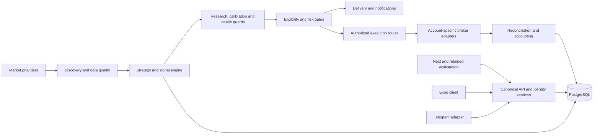

# SignalRankAI master execution contract

## Continuation, 30 October 2026 — prop dashboard, and a broker-account read crash (owner request)

Commits `9734fd2b` (read fix), `7eb0d9f5` (dashboard data), `01fbd61a` (web view) and `f89697eb` (governance). Nothing was deployed.

- **Bug found and fixed (CX-SEC-04, CX-PROP-03).** Five broker-account functions read database rows after a rollback, which expires them: `get_account_policy`, `reconciliation_snapshot`, `list_account_ledger`, `evaluate_persisted_account_policy` and `record_reconciliation`. On real PostgreSQL every call raised `DetachedInstanceError` whenever the row existed. So:
  - the policy and ledger endpoints errored for any account with a policy or ledger entries;
  - the execution admission check crashed, failing closed.

  The existing tests used in-memory fakes and could not see it. All five now copy what they need first, and a PostgreSQL test drives them against real rows.
- **Prop dashboard (CX-PROP-04).** The Brokers view shows, for any account with a policy:
  - today's loss and total drawdown as meters of the effective limit, using the execution gate's own formulas, limits and the account's reset time zone;
  - current, day-start and highest equity.

  For PROP accounts it adds trading days (days with fills) against the minimum, profit-target progress, and a form for starting balance, target and minimum trading days. Those objectives come from the firm's rules as the owner enters them, are stored on the connection and are display-only: no gate reads them, and saving them leaves the risk policy, its version and certification unchanged. Missing or stale (over 15 minutes) broker data shows as unavailable, never as zero. No firm rules were invented; CX-PROP-02 (verified rule profiles) remains an owner decision.
- **Verified:**
  - 12 dashboard tests (2 on PostgreSQL), including agreement with `evaluate_account_policy` on the same numbers;
  - 1 PostgreSQL regression test for the read fix;
  - a headless-Chromium run on the owned local stack with a synthetic PROP account: every figure matched a hand calculation, saving objectives left the policy at version 1, and axe WCAG 2.2 AA found no violations in either theme. Full suite at `f89697eb` (Windows 11, Python 3.13.7, owned PostgreSQL 17 migrated from empty to `0057`, `SIGNALRANK_POSTGRES_INTEGRATION_REQUIRED=1`): **4,354 passed, 1 failed, 2 skipped**; the failure is the environmental `release_provenance[isolated_metadata]` case.

## Continuation, 30 October 2026 — economic calendar and news blackout (owner request)

Commits `d6949b09` (fix and tests) and `c27ced4d` (governance). Nothing was deployed.

Writing tests for the economic calendar (CX-RISK-01, CX-SIG-22) exposed five bugs, all fixed:

- **The blackout never blocked anything in the all-in-one runtime.** `railway_main` runs the engine loop in an executor thread. There the sync gate's `asyncio.get_event_loop()` raised, and the wrapper swallowed the error and returned False. The gate now uses `utils.async_runner.run_sync` with a 20-second bound. When it cannot be evaluated it still does not block (existing policy), but logs a warning at most every 10 minutes.
- **One failed feed fetch disabled news protection everywhere for an hour.** The timeless static fallback was cached in Redis. It is no longer shared, old entries are ignored, and the live feeds are retried after 5 minutes. `calendar_status()` reports whether real event times are loaded.
- **The database copy of the calendar was always empty.** The sync worker read `event_date` while events carry `event_time`. It also compared timezone-aware values with the naive column, which PostgreSQL rejects (reproduced locally). It now stores naive UTC.
- **The database and Redis copies dropped just-past events,** losing the blackout after a release; they keep the last 2 hours.
- **`EUR/USD`-style symbols were not recognised.**
- **Tests:** 10 new (1 on real PostgreSQL); 6 of them fail on the previous code; 261 related tests pass. Full suite at `c27ced4d` (Windows 11, Python 3.13.7, owned PostgreSQL 17 migrated from empty to `0057`, `SIGNALRANK_POSTGRES_INTEGRATION_REQUIRED=1`): **4,337 passed, 1 failed, 2 skipped**; the failure is the environmental `release_provenance[isolated_metadata]` case.
- **Behaviour change after promotion:** the 60-minute blackout around high-impact USD events will actually suppress signals for USD-sensitive assets (major USD pairs, gold and silver, BTC/ETH and the US indices) in the all-in-one runtime. This was always the design, but it was not working there.
- **Owner decision (30 Oct): keep fail-open.** When no calendar source is available the gate lets trading continue; fail-closed would stop USD-sensitive signals during every feed outage. Recorded in `requirements_conflicts.md` and locked by `tests/test_owner_decisions_20261030.py`, which also checks the blackout still blocks when event times exist.

## Continuation, 29 October 2026 — backtest execution realism (owner request)

Commits `a062edd9` (harness) and `516b2023` (governance). Research tooling only; nothing deployed and no engine behaviour changed.

- **Problem (CX-BT-01).** `scripts/backtest_zone_rejection.py` had four optimistic assumptions:
  - it filled every trade at the signal bar's close, a price known only once that bar has closed;
  - it filled targets on a touch;
  - it ignored gaps through stops;
  - it charged one flat round-trip percentage.
- **New default execution (`--cost-model realistic`).** It follows the conventions of `engine/backtest_execution.py`:
  - **Entry:** a market order at the next bar's open, paying half the spread plus slippage. An open already past the stop or target cancels the trade (`no_fill`).
  - **Stops:** fill at the stop, or at the open on a gap, so losses can exceed 1R.
  - **Targets:** limit orders that fill only when price trades through by half the spread, with no price improvement.
  - **Fees and funding:** taker fees on market and stop fills, maker fees on targets, optional perpetual funding.
  - **Reporting:** R stays the planned risk. Each trade reports its fills, `fees_r` and `friction_r`.

  Defaults (5/2/2/3 bps) suit liquid crypto majors and are all flags. `--cost-model flat` reproduces the 28 Oct model for comparison.
- **Verified:** 8 new tests with hand-computed fills, fees and funding; the command-line path was checked end to end on a 200-day synthetic random walk, where friction was 0.07–0.20R per trade. That is plumbing evidence, not strategy evidence: market-data hosts are still unreachable from this machine, so no real-data backtest has been run. Full suite at `516b2023` (Windows 11, Python 3.13.7, owned PostgreSQL 17 migrated from empty to `0057`, `SIGNALRANK_POSTGRES_INTEGRATION_REQUIRED=1`): **4,327 passed, 1 failed, 2 skipped**; the failure is the environmental `release_provenance[isolated_metadata]` case.
- **Still not modelled:** order-book depth and market impact, partial fills, borrow costs and corporate actions.

## Continuation, 29 October 2026 — owner Telegram menu (owner request)

Commits `767e6e95` (fix) and `2f892415` (governance). Nothing was deployed.

- **Problem (CX-TG-01).** The owner can use 123 catalogue commands, and Telegram's menu holds 100 per scope. The list was cut in catalogue order, so the owner's menu lost the 23 commands at the end. These were the owner's own controls: `kill_switch`, `system_health`, `queue_status`, `queue_replay`, `release_status`, and the audit and dead-letter tools.
- **Fix.** For owner and admin menus over the limit, 25 customer onboarding, buying, referral and setup commands are left out of the menu (`OPERATOR_MENU_OMIT` in `signalrank_telegram/command_catalog.py`). If the catalogue outgrows that too, operator commands are kept before customer ones. The owner menu now has 98 commands, including all 55 operator commands. Customer menus and the admin menu (98) are unchanged. Every command still works when typed, and `/help` still lists all of them. The bot republishes menus when it starts.
- **Tests:** 6 new; 276 related tests pass. Full suite at `2f892415` (Windows 11, Python 3.13.7, owned PostgreSQL 17 migrated from empty to `0057`, `SIGNALRANK_POSTGRES_INTEGRATION_REQUIRED=1`): **4,319 passed, 1 failed, 2 skipped**; the failure is the environmental `release_provenance[isolated_metadata]` case.
- **Local environment note:** the owned PostgreSQL test cluster stopped at 19:23 after a Windows process-start failure (`0xC0000142`). It was restarted, recovered cleanly, and the throwaway full-suite databases from earlier runs were dropped.

## Continuation, 29 October 2026 — client address trust (owner request)

Commits `57e56058` (fix) and `bf067ce2` (governance). Nothing was deployed; production still runs `9865a3d1`.

- **Problem.** Rate limits, the IP stored with security events, and the Paystack webhook IP allowlist all took the first `X-Forwarded-For` value, which the client chooses. Railway's public networking specification says its edge sets `X-Real-IP` to the client's remote address, and does not mention setting `X-Forwarded-For`. The production domain resolves directly to Railway's edge, with no CDN in front.
- **Fix (CX-SEC-02, threat TM-42).** `core/client_ip.py` trusts, in order:
  1. an address signed by our web proxy (HMAC-SHA256 with `SIGNALRANK_CLIENT_IP_SECRET`, 5-minute window);
  2. `X-Real-IP` on Railway (override with `TRUSTED_CLIENT_IP_HEADER`);
  3. the socket peer.

  The first `X-Forwarded-For` value is never used. The rate limiter, security events and the Paystack allowlist all use this resolver. The Next.js proxy no longer forwards browser-supplied forwarding headers: it passes the edge-set address, signed when the secret is set.
- **Owner check after deployment.** New owner-only `GET /api/v1/platform/operator/request-identity` shows the address and source the server derived from your own request.
- **Not observed.** That the edge replaces a client-supplied `X-Real-IP` comes from Railway's documentation; production cannot be inspected without deploying. Reading the web service's variables (to learn whether the web app reaches the API privately or through the public edge) was refused by the production-read guard and not attempted another way.
- **Tests:** 14 Python and 4 frontend tests, including a signature test vector shared by both languages; 475 related Python tests pass. Full suite at `bf067ce2` (Windows 11, Python 3.13.7, owned PostgreSQL 17 migrated from empty to `0057`, `SIGNALRANK_POSTGRES_INTEGRATION_REQUIRED=1`): **4,313 passed, 1 failed, 2 skipped**; the failure is the environmental `release_provenance[isolated_metadata]` case.

## Continuation, 29 October 2026 — threat model revision, security fixes, accessibility audit (owner request)

Commits `6360f648`, `0243af1f`, `8c2c15e4` and `64e5653d` (security fixes); `6bc1f02b` (threat model); `d9d28e15` (accessibility); `28c0c39e` (governance). Nothing was deployed; production still runs `9865a3d1`.

- **Threat model (CX-SEC-01).** `docs/security/THREAT_MODEL.md` gains section 12, extending the 26 Sep model (schema `0045`) to `0057`. It covers new surfaces, trust boundaries TB-09 to TB-13 and threats TM-28 to TM-41, each with the control read in the code and its tests. Sections 1–11 are unchanged. Open items are stated as risks, not exploit steps, because the repository is public.
- **Fixed while modelling (CX-SEC-02):**
  - **Webhook address pinning:** a delivery now connects only to the address that passed validation, which closes DNS rebinding. Non-public ranges are refused, TLS is still verified against the real hostname, and connections are not reused across customers.
  - **Per-account sign-in limit:** 10 failed passwords in 15 minutes lock password sign-in, whatever the forwarded IP. Unknown emails are counted too, so the lock reveals nothing.
  - **Account email cap:** at most 5 sign-in-link and 5 reset emails per account per hour, with an identical reply when capped.
  - **Private-chat-only bot commands:** in groups, only eight public-information commands answer.
- **Supply chain and secrets (CX-SEC-06, CX-AUTH-04).** On 29 Oct, `pip-audit` on `requirements.lock` found 0 known vulnerabilities in 135 packages, and `npm audit --omit=dev` found 0. A secret-pattern scan of tracked files found only false positives.
- **Accessibility (CX-WEB-02).** New `scripts/a11y_audit.py` runs axe-core's WCAG 2.2 A/AA rules on 40 pages (public, legal, workspace), in two themes at two widths. A 320 px pass adds reflow, skip-link and visible-focus checks. Before the fixes, 128 of 140 runs failed (1,067 colour-contrast nodes, 62 name mismatches); after, 0 of 200 fail. The fixes:
  - muted-text tokens now meet at least 4.8:1 and 5.3:1;
  - the menu's accessible name starts with "Menu";
  - public pages have a skip link;
  - the legal pages' mis-encoded link name is corrected.

  Evidence: `docs/release/evidence/continuation-20261029/a11y_audit.json`. Screen readers, full keyboard journeys and real devices remain manual.
- **Tests:** 17 new Python tests (5 on real PostgreSQL) and 3 new frontend tests; 598 related Python tests pass. Full suite at `28c0c39e` (Windows 11, Python 3.13.7, owned PostgreSQL 17 migrated from empty to `0057`, `SIGNALRANK_POSTGRES_INTEGRATION_REQUIRED=1`): **4,299 passed, 1 failed, 2 skipped**; the failure is the environmental `release_provenance[isolated_metadata]` case.
- **Still open:** confirm how the hosting edge sets `X-Forwarded-For` before changing IP-keyed rate limits; an external security review (CX-SEC-07); manual accessibility checks.

## Continuation, 29 October 2026 — Telegram /watchlist and /journal (owner request)

Commits `5b2ef71a` (commands and shared services), `e09f65ce` (governance), `17c15b15` (web watchlist controls), `f591ceca` (governance). Nothing was deployed; production still runs `9865a3d1`.

- **Shared services (CX-CHAN-01, CX-PROD-03).** `services/platform/watchlists.py` and `services/platform/journal.py` now hold the SQL the web endpoints used; the web endpoints and the bot both call them, so a list or entry made in one channel appears in the other for the same canonical account. Web responses are unchanged apart from two additions: a blank watchlist name is refused (422), and each watchlist item carries its `display_symbol`.
- **`/watchlist`** (free, as on the web): list every watchlist with symbols; `add`/`remove` by symbol or exact instrument id; `new`; `delete <name> confirm`. A symbol shared by several active instruments (for example spot and perpetual) is never guessed: the candidates are listed. A mistyped symbol creates nothing; only a successful add creates the default list.
- **`/journal`** (free): the latest five entries; `add <text> #tags`; `delete <id> confirm` with a short id (six or more characters, own entries only).
- Both commands answer only in a private chat, so journal content is never posted to a group.
- **Web watchlists** now show symbols, remove one instrument at a time, and delete a list after a second click. Before this, the web had neither control even though the API offered both. A presentation test that pinned "no DELETE calls" now allows exactly those two routes.
- **Parity matrix:** the watchlists and journal sections now map to commands. The generator now lets a singular command match its plural route, which adds 10 route matches; each was reviewed and is a true match.
- **Verified** end to end on the owned local stack: a list and an entry made through the real bot handlers appeared on the web pages, and an entry, a removal and a deletion made on the web were reflected by the bot. Real Telegram delivery was not exercised: no bot token was used locally.
- **Known limit (pre-existing):** Telegram's command menu holds at most 100 commands per scope. Every tier's menu includes both new commands (free 40 of 40, admin 98 of 98), but the owner menu shows 100 of 123 catalogue entries (previously 100 of 121), so the last 23 owner and admin entries are missing from it. `/help` still lists all of them. *(Fixed later on 29 Oct: the owner menu now keeps every operator command.)*
- **Tests:** 9 new Python tests (7 on real PostgreSQL) and 3 new frontend tests; 358 related Python tests pass. Full suite at `e09f65ce`: 4,282 passed, 1 failed, 2 skipped. Full suite at the final code commit `f591ceca` (Windows 11, Python 3.13.7, owned PostgreSQL 17 migrated from empty to `0057`, `SIGNALRANK_POSTGRES_INTEGRATION_REQUIRED=1`): **4,282 passed, 1 failed, 2 skipped**; the failure is the environmental `release_provenance[isolated_metadata]` case.

## Continuation, 29 October 2026 — engine reliability: bounded database calls, owner alerts, owner screens

Commits `b0bf1c78` (timeouts), `3bfda44a` (owner alerts), `510dd352` (owner screens), `86cd8c6d` (docstring correction), `82c35b66` (governance). Nothing was deployed; production still runs `9865a3d1`. No financial permission changed.

- **Bounded database calls (CX-Q-05).** The five `run_sync` database calls in the engine loop that had no timeout (decision log, ML rejection record, ML prediction log, exposure check, notification fan-out) now carry `ENGINE_DB_CALL_TIMEOUT_SECONDS` (default 10 s, clamped to 1–120 s; the fan-out has a 45 s outer bound). The exposure check refuses the trade on a timeout. `run_sync` ignored its timeout when background threads were disabled; fixed. A source test fails if an unbounded call is added. *Correction:* the 28 Oct sections said thirteen calls were unbounded; the count was five, plus one fallback reached only when the async runner cannot be imported.
- **Owner alerts (CX-OBS-04).** Telegram alerts to `OWNER_IDS`, de-duplicated across processes, each ending with a runbook line: `engine_stalled` (sent by the stall watchdog before a dedicated engine exits); `engine_silent` (a worker loop, `OWNER_ALERTS_ENABLED` default on, every `OWNER_ALERTS_INTERVAL_SECONDS`=120, when the engine heartbeat is missing, stalled or older than `OWNER_ALERT_ENGINE_SILENT_SECONDS`=900); `queue_age` (oldest undelivered `event_outbox` row or Telegram update older than `OWNER_ALERT_QUEUE_AGE_SECONDS`=300); the existing `provider_outage` alert now carries its runbook. The queue-age reads are read-only and never create a stream or group. Delivery to real Telegram was not exercised.
- **Owner web screens (CX-RISK-04, CX-USER-02, CX-COST-01, CX-ADMIN-01).** Operations gains scoped kill switches (engage with a reason and the typed phrase `ENGAGE`, two-step release, audit trail), account-merge review (read-only preview; owner-only apply needing a tick and the exact merge id) and AI spend (budgets, spend by provider, workload, model and user). The backend still enforces owner authority, confirmation and a recent sign-in. Exercised end to end on the owned local stack with a synthetic owner: a switch engaged and released, a merge refused for a wrong id and completed for the right one (two watchlists, a journal entry and the Telegram identity moved), spend shown from three ledger calls; no horizontal overflow at 375 px.
- **Tests.** 5 timeout tests, 10 alert tests (1 on real PostgreSQL), 4 frontend contract tests; 338 related Python tests pass; frontend 71 transport and 38 presentation tests, `tsc` and `eslint` clean. Full Python suite at `82c35b66` (Windows 11, Python 3.13.7, owned PostgreSQL 17 migrated from empty to `0057`, `SIGNALRANK_POSTGRES_INTEGRATION_REQUIRED=1`): **4,273 passed, 1 failed, 2 skipped**; the failure is the environmental `release_provenance[isolated_metadata]` case seen in earlier runs.
- **Still blocked on the owner:** `PROMOTE_TO_PRODUCTION` (migrations `0054`–`0057`), provider keys and plans, a staging environment, GitHub Actions billing.

## Continuation, 28 October 2026 — shadow evidence for the expectancy gate (owner decision)

Commits `136290b8` (feature), `4ad62330` (schema head `0057_expectancy_shadow_index`), `698a0191` (promotion plan). The owner chose to build shadow evidence and keep `EXPECTANCY_HARD_BLOCK_ENABLED` on. Nothing was deployed.

- Candidates refused only for `expectancy_unavailable` are recorded once per setup as `decision_log` rows with `layer='expectancy'` (de-duplicated 24 h; `EXPECTANCY_SHADOW_RECORDING_ENABLED`, default on).
- A second shadow tracker (`layer='expectancy'`, own cursor and health key) follows them to stop or final target and stores realized R; ambiguous bars count as −1 R; it writes no ML shadow predictions or metrics.
- With `EXPECTANCY_SHADOW_BOOTSTRAP_ENABLED=1` (default off) the gate may use that evidence only with at least twice the live minimum sample (20) and only if the lower 95% bound of expectancy after a 0.05 R cost haircut is at least `EXPECTANCY_MIN` (0.15 R); the gate sees that bound, never the mean.
- Migration `0057_expectancy_shadow_index`: concurrent, validated partial index; `EXPLAIN` on a 50,000-row table shows index scans for both the tracker and the evidence query; upgrade/downgrade/upgrade passed.
- Tests: 8 new (2 on real PostgreSQL); 207 related tests pass. Full Python suite at `698a0191` (Windows 11, Python 3.13.7, owned PostgreSQL 17 migrated from empty to `0057`, `SIGNALRANK_POSTGRES_INTEGRATION_REQUIRED=1`): **4,258 passed, 2 failed, 2 skipped**; failures are V7 governance freshness (regenerated next) and the environmental `release_provenance[isolated_metadata]` case.
- Expected timeline after promotion: shadow trades accumulate while the engine runs; with the flag on, the first asset can qualify only after 20 tracked outcomes with a strongly positive lower bound. Until then the gate stays shut, by design.

## Continuation, 28 October 2026 — third pass: signal blockers, AI cost ledger, parity, data providers

Branch `feat/frontend-rebuild-and-stage1-hardening`, commits `8495d912` … `42f212a2` after `f3dd85c7`. Stage 1 and release remain NO-GO. Railway was read only except the owner-approved engine restart recorded above; nothing was deployed or migrated in production.

- **Crypto signals are blocked by an expectancy lockout (finding, not changed).** Production sets `EXPECTANCY_HARD_BLOCK_ENABLED`; `live_expectancy` is only populated from at least `EXPECTANCY_MIN_SAMPLE` (10) proof-backed delivered outcomes in 30 days. With no deliveries since early October, every candidate is refused with `risk/expectancy_unavailable` and the gate can never reopen by itself. Shadow tracking covers only ML-layer rejections, so no counterfactual evidence accumulates either. Resolving it is an owner decision (see the blockers list); no gate or threshold was changed.
- **Data providers (`8495d912`).** Connectors returned `[]` for every failure and logged the cause only at debug level, so production showed `insufficient_candles candles=0` for all FX/index/commodity requests. They now record the cause (`api_key_missing`, `rate_limit_cooldown_active`, `http_NNN`, `empty_response`, ...), which the fetcher appends to the failure reason, warned once per window. Defects fixed: Polygon received raw platform symbols instead of `I:`/`C:`/`X:` tickers; yfinance asked Yahoo for `BRENT` (now `BZ=F`), had no index mapping, and builds 4h bars from UTC-aligned 1h bars. 29 tests.
- **AI cost and usage ledger (CX-COST-01, CX-AI-06; `ab68f97b`).** Migration `0056_ai_usage_ledger` (append-only tables by trigger); every OpenAI/Gemini call reserves worst-case cost before the call and settles after; budgets from the environment are enforced under an advisory lock and an exhausted budget skips the AI step (deterministic review applies); without budgets it records only. `/operator/ai-spend` summarises spend. 16 tests on real PostgreSQL; `0053 → 0056 → 0053 → 0056` rehearsed on seeded data with `auto_renew` values unchanged. Every `EXPECTED_ALEMBIC_HEAD` pin moved to `0056_ai_usage_ledger` (`234c6231`).
- **Web/Telegram parity (CX-CHAN-01, CX-TG-01; `a3cd967d`).** Quality, privacy, feedback and operator authority are shared services used by the web API and the bot; `/quality`, `/privacy`, `/feedback` and `/account_merges` added or extended in Telegram; mutating owner controls stay web-only. `TELEGRAM_WEB_PARITY_MATRIX.md` is generated from the code (`scripts/build_parity_matrix.py`); remaining gaps it names include watchlists and the journal. 33 tests.
- **Order-block ABC strategy (`267a3339`, `42f212a2`).** Closed-bar-only evaluation, stop beyond every extreme since C, day-correct 4h dealing range and daily-to-4h mapping fixed (16 tests). A causal replay backtest harness was added (5 tests) but not run on real data: Binance, Coinbase, Bybit, KuCoin, OKX, Kraken, Gate.io and Dukascopy were unreachable from this machine (DNS/network filtering). The strategy stays disabled.
- **Work from the three sessions that stopped at their usage limit** (AI ledger, backtest, parity) was found uncommitted in this worktree, reviewed, completed where needed (one raw-exception Telegram reply fixed, missing parity matrix written, head pins and one source-pinned test updated) and committed separately.
- Full Python suite at `42f212a2` (Windows 11, Python 3.13.7, owned PostgreSQL 17 migrated from empty to `0056`, `SIGNALRANK_POSTGRES_INTEGRATION_REQUIRED=1`): **4,250 passed, 2 failed, 2 skipped**. Failures: V7 governance freshness (artifacts regenerated in the following commit) and the environmental `release_provenance[isolated_metadata]` case (`alembic` only in user site-packages, excluded by `python -I`).

## Continuation, 28 October 2026 — engine stall root cause, owner strategy, dependency verification

Branch `feat/frontend-rebuild-and-stage1-hardening`, commits `6c14af7d` and `5b7eb4c5` after `dce7bd8c`. Stage 1 and release remain NO-GO. Railway was read only (environment status, deployment lists and logs); nothing was deployed, restarted, migrated or reconfigured.

- **Production engine root cause (CX-Q-05, CX-FACT-06).** `striking-optimism` logged its last pipeline step at 2026-10-22 08:08:30 UTC (`PENGUUSDT`), immediately after `Postgres-R8Lr` was redeployed at 08:07:47 and the engine's connections broke at 08:08:35; it has logged nothing since, yet Railway reports it Online with one running replica and no failures. Thirteen database calls in the loop use `run_sync` without a timeout. *(Corrected 29 Oct: five calls, not thirteen; all bounded since `b0bf1c78`.)* Fix: an engine stall watchdog that logs the stuck call's stack, publishes a not-ready `stalled` heartbeat and, for a dedicated engine role, exits with code 70 so the `ON_FAILURE` policy restarts it (`5b7eb4c5`, 7 tests). Not deployed: the running engine stays stalled until it is restarted.
- **Engine restarted at the owner's request** (28 Oct, ~05:40 UTC; `striking-optimism` restarted in place on deployment `d6423329`, still `9865a3d1`; no deploy, migration or configuration change). Production `/readyz` became `ready` with every check passing for the first time since the stall; cycles 5→11 in about five minutes with heartbeat age under 60 s. Signals remain 0: crypto candidates (18–38 per batch, scores up to 81) are refused by the risk gate with `risk/expectancy_unavailable`, and FX/index/commodity assets have no candles from their providers. Gates unchanged; these need an owner decision (expectancy bootstrap) and provider fixes.
- **Other signal-drought causes seen in the same logs (not changed):** several FX, index and commodity providers returned 0 candles (Tiingo, Twelve Data, Polygon, yfinance), and BTCUSDT candidates were refused with `risk/expectancy_unavailable`.
- **PR #202 was not deployed.** Railway created no deployment for `4f4f6d33`; every application service still runs `9865a3d1` (12 Oct). Earlier pushes show automatic deployments SKIPPED and later deployed manually.
- **Owner strategy videos.** The 23 Jun 2026 (XAUUSD) and 6 Aug 2026 (USDCAD) recordings were reviewed from 67 extracted frames and a machine transcript (the first recording's audio is unusable). Implemented as `strategies/zone_rejection.py` (`Order Block ABC (Top-Down)`, `order-block-abc-v1`): 1d/4h order block, premium/discount filter on the 1d range, 4h break of structure, 15m (else 5m) ABC where C takes A and the latest closed bar is the first close through B, target the nearer of the 50% equilibrium and the 4h liquidity, minimum 2R. Group `zones`, 5m/15m capability, disabled unless `ZONE_REJECTION_STRATEGY_ENABLED` is set (`6c14af7d`, 11 tests). No backtest or shadow evidence yet; enabling needs owner approval.
- **Full Python suite with the upgraded dependencies** at `fa223df4` (Python 3.12 venv from `requirements.lock`, owned PostgreSQL 17 migrated from empty, `SIGNALRANK_POSTGRES_INTEGRATION_REQUIRED=1`): **4,145 passed, 1 failed, 2 skipped**. The failure, `test_provider_certification_boundaries.py::test_positive_infinity_cannot_hang_any_timestamp_normalizer`, is a 15 s subprocess deadline hit by cold imports in the new venv; it passes on re-run in about 4 s (twice).

## Continuation, 27–28 October 2026 — second pass: engine diagnostics, risk, identity merge, security

Branch `feat/frontend-rebuild-and-stage1-hardening`, commits `21e5c509` … `f95f9785`. Stage 1 and release remain NO-GO; nothing was merged, deployed or migrated against any shared system, and no financial permission changed. Environment for all evidence below: Windows 11, Python 3.13.7, an owned PostgreSQL 17 cluster on `127.0.0.1:55434` created for this session, Node 22.19 with npm 11.17.0. Not CI, staging or production.

- **Engine stall diagnostics (P0).** Five early cycle exits (circuit breaker active or failing closed, no assets, off-market throttle, empty queue) wrote no `engine:last_cycle`, so a live engine skipping every cycle looked stopped. They now publish `status: skipped` with the reason; readiness still treats `skipped` as not ready and names the reason (`2288ce6e`). The production root cause still needs Railway logs.
- **Runtime identity (CX-OBS-03).** `/version` reports the code's Alembic head and a UTC build stamp written by the Nixpacks build phase (`bd257421`, `131224e7`). `image_digest` stays `unknown` under Nixpacks.
- **Migration rehearsal.** `0053 → 0055 → 0053 → 0055` with plain Alembic and `0053 → 0055` through `scripts/controlled_migrate.py`, on 5,000 users and 200,000 decision rows: existing `auto_renew` values unchanged, index valid, downgrade clean. Found that the guarded migration also needs `PRODUCTION_DB_VOLUME_SIZE_MB` and a volume observation under one hour old; the promotion plan now lists it. Evidence: `evidence/continuation-20261027/migration_rehearsal_0053_0055.json`.
- **Risk.** Audited strategy/instrument/asset-class kill switches enforced at the MT5 and Bybit chokepoints, fail closed (`31770c17`). Real-PostgreSQL race: 12 simultaneous reservations against a limit of 3 approve exactly 3; found and fixed every quota refusal being reported as `execution_quota_unavailable` (`41e16c3b`). `engine/correlation_guard.py` and `core/risk_authority.py` are not wired into runtime.
- **Focused universe in ML training** (`fdcfefe0`) and **per-strategy/instrument/timeframe/layer rejection breakdowns** on `/quality` and the web Quality view (`6cc5f94c`, `b51d3db7`).
- **Telegram ↔ web account merge.** A web account linking a Telegram identity with existing bot history stopped at `merge_review` forever. Reviewed merges can now be previewed and completed (owner endpoints, `python -m tools.complete_account_merge`) in one transaction: rows referencing the archived account move only when no unique index collides and owned parent rows move with them; nothing is deleted; credentials and sessions never move; paid tier and the renewing subscription follow the person (`3febf802`). 5 real-PostgreSQL tests.
- **Security.** Next.js `16.3.8 → 16.4.2` (critical unauthenticated RCE advisories GHSA-2464-fhr4-w9xw, GHSA-673q-mjm6-r5xr) and zod; `npm audit`: 0 vulnerabilities (`630163db`). pip-audit of `requirements.lock`: 49 advisories in aiohttp, certifi, opentelemetry-api and Pillow; bumped to aiohttp 3.14.5, certifi 2026.10.19, OpenTelemetry 1.45.1/0.66b1, Pillow 13.0.0, respecting the 7-day release-age rule (`242eefc3`). Baseline `nosniff`, `no-store` and HTTPS-only HSTS on direct API responses; HSTS on the web app (`eaa11d9d`).
- **Audit.** Global and scoped kill-switch changes now write `security_events` rows, best effort so a switch never fails on audit (`f95f9785`).
- **Web.** Production build run locally against the local API. At 320 px the public Menu button was off-screen (fixed, regression test). A window with zero quality decisions now says the engine most likely did not run. Basic accessibility sweep clean on Settings, Signals and Login.
- **Tests.** Full Python suite at `eaa11d9d` on real PostgreSQL 17 (database migrated from empty to `0055`, `SIGNALRANK_POSTGRES_INTEGRATION_REQUIRED=1`): **4,138 passed, 4 failed, 0 skipped**. Failures: V7 governance freshness (artifacts not yet regenerated at that commit; regenerated before push), `release_provenance[isolated_metadata]` (environmental: `alembic` only in user site-packages, excluded by `python -I`), and two host-timezone privacy cases that call POSIX-only `time.tzset` (now skipped where unavailable, `4d8d596d`). Frontend at `630163db`: tsc, eslint, `next build` and 108 node tests pass.
- **Production promotion** was requested again; not executed. It still needs the owner phrase `PROMOTE_TO_PRODUCTION`, Railway access for backup and `EXPECTED_RELEASE_COMMIT` on every service, and the guarded migration (plan updated with the volume gate). The promoted code would now also change the Nixpacks build phase and Python/Node dependency versions listed above.

## Continuation, 27 October 2026 — runtime schema identity

Branch `feat/frontend-rebuild-and-stage1-hardening` (from `5f848d96`; code commit `bd257421`). Stage 1 and release remain NO-GO; nothing was merged, deployed or migrated, and no financial permission changed.

- CX-OBS-03 (partial fix): `/version` now reports the code's single Alembic head when `EXPECTED_SCHEMA_HEAD` is unset, resolved independently of the working directory, instead of `unknown`. An explicit `EXPECTED_SCHEMA_HEAD` still wins. `build_timestamp` and `image_digest` still depend on build-provided variables and stay `unknown` until the build sets them. Test: `tests/test_version_schema_head_20261027.py` (3 passed locally; the first case fails on the previous code). Not deployed, so production still reports `unknown` until an authorized promotion.
- Production promotion was requested in chat on 27 Oct without the `PROMOTE_TO_PRODUCTION` phrase or the prerequisites in [PRODUCTION_PROMOTION_PLAN_20261024.md](PRODUCTION_PROMOTION_PLAN_20261024.md) (backup evidence, `EXPECTED_RELEASE_COMMIT` on every service, guarded `0054`/`0055` migration). Not executed.

## Continuation, 24 October 2026 — frontend rebuild, live readiness finding, independent audit

Branch `feat/frontend-rebuild-and-stage1-hardening` (from `393f3d88`; commits `7946fa25`, `840abd90`, `801780d4`, `7a63d5ac`, `8a7d3e3b` and this documentation commit). Stage 1 and release remain NO-GO; nothing was merged, deployed or migrated, and no financial permission changed.

- Web frontend rebuilt on a new design system; billing (server-priced Paystack checkout, verified confirmation, auto-renew cancel, refund review) and signal feedback wired to existing APIs. Local evidence: tsc, eslint, `next build`, 98 node tests at the time of commit; 61/61 pre-rebuild API calls and 11/11 routes retained (`frontend/scripts/api-baseline.test.mjs`).
- Focused-universe admission now guards both signal persistence paths and the MT5/Bybit execution chokepoints (no-op unless enabled in staging). HTTP 451 classified as `REGION_RESTRICTED`; Binance region blocks logged and backed off.
- Live read-only `/readyz` (deployed `9865a3d1`) returns 503: only `engine_runtime` fails — the `engine:last_cycle` heartbeat is absent, so the production engine is not cycling (Engine Pulse: 0 signals in window). Probe now reports `engine_heartbeat_missing`. Root cause needs Railway logs (blocked: access). Production DB is at `0053`; repository head `0055`.
- New owner source `message.txt` (SHA-256 `b78374d0…`) consolidated privately into 287 requirement IDs; hashes and anchors only in `evidence/continuation-20261024/source_intake.json`.
- Full Python suite at clean commit `e9b2b368` on a local PostgreSQL 16.2 database migrated from empty to `0055`: **4,098 passed, 0 failed, 1 skipped** (pyarrow not installed); multi-user isolation suite 5/5. Three pre-existing test portability/isolation defects fixed. Local only; GitHub Actions remains billing-locked. Limits in the audit §8.

Full details, classifications and information gaps: [INDEPENDENT_ACCEPTANCE_AUDIT_20261024.md](INDEPENDENT_ACCEPTANCE_AUDIT_20261024.md).

## Stage 0 safe local Git and historical forensics, 22–23 October 2026

The exact observed source is e01e7c41f49a3e35335b00edc2de97367aa2dade. Evidence: [Stage 0 forensics index](evidence/continuation-20261022/index.json). Stage 1 and release remain NO-GO.

Non-destructive remote fetch confirmed zero stale remote refs; `origin/fix/stage1-canonical-reconciliation-20261014` is at 393f3d88. Branch audit across 247 refs (4,695 reachable commits) verified 218 ancestor-preserved refs, 1 patch-equivalent/merge-only ref, and 28 divergent refs containing 118 unique commits matching historical reviewed dispositions with 0 missing and 0 moved heads. Single migration head `0055_user_renewal_default` is confirmed. 18 worktrees discovered: 17 clean, 1 dirty worktree (`.pytest-tmp/release-ci-closure-20261007`) preserved untouched with 25 uncommitted entries analyzed. Draft PR #201 remains OPEN under active ruleset 24410166; hosted CI runs remain failed at zero steps due to account billing lock. Live route check on `https://www.signalrank.criloxsolutions.com` confirms `/` (200 JSON), `/login` (404), `/app` (200 HTML), `/healthz` (200 JSON), `/pricing` (404); public Next cutover remains unserved. Railway CLI session is expired (BLOCKED_EXTERNAL for fresh authenticated control-plane re-verification). All 5 release governance checks pass with 0 drift.

## Exact correction verification, 18 October 2026

The exact tested source is 393f3d88d6018d01c3f04234cc9c44b23a5de8fc. Evidence: [correction index](evidence/continuation-20261018/correction-393f3d88/index.json). Stage 1 and release remain NO-GO.

The immutable-attempt wrapper and legacy HTML correction have passed a clean full local system run: **4,080 passed, zero failed/errors/skips** across 32 checks. OpenGrep completed its probe and strict scan: 575 files, 476 rules, zero findings, zero errors. The legacy production-build browser drill also passed using synthetic accounts, an owned migrated PostgreSQL database and a confirmed cleanup of servers, database and key.

The runtime source is now frozen at this revision. The later handoff commit carries only evidence and governance material; it is not a second tested-code claim. The passing checks neither exercise external providers nor authorize broker, payment, Telegram, native-device, staging, production or real-money behavior. Retain the mobile dependency audit failure and every prior failed diagnostic.

## Frozen local pass and follow-up correction, 18 October 2026

The exact tested source is 2ee0a918d915549f7f5ce59d59f0a8a07d2202a9. Evidence: [frozen run index](evidence/continuation-20261018/frozen-2ee0a918/index.json). Stage 1 and release remain NO-GO.

The full system run passed 4,076 tests, zero failed/errors/skipped, plus all 12 local system checks. Both actual browser workspace modes passed and their owned servers, databases and keys were cleaned up. These results replace the stale-governance failure only at local suite scope.

A strict static scan failed on bare ampersands in two legacy HTML pages; the characters are now escaped. A synthetic probe and four regressions confirmed that the local wrapper could overwrite previous attempts and lose launch failures. Exclusive output creation and explicit launch-failure receipts fix that defect; ten modified-source wrapper tests pass. Freeze and verify this correction next. Do not extend the 2ee0a918 receipt to these later source edits.

Thirteen seed dispositions now have explicit reviewed mappings/gaps. Full semantic reconciliation is unfinished; no whole requirement has been promoted to verified. Use unique attempt names. Keep failed and partial artifacts. The generation order below remains mandatory.

## Verification continuation, 18 October 2026

Clean unchanged 7c3f7e0f completed the full local system run: 4,075 passed,
one failed, zero skipped. The sole failure is the generated V7 governance
inventory, which was produced before the final retained evidence and register
updates. The failure is retained in evidence/continuation-20261018/index.json;
no runtime behavior is waived by identifying the generator-order error.

On that same commit, all five local manifest gates, 63 frontend tests, 53 mobile
tests, frontend lint, mobile typecheck, Android/iOS JS exports and the real Next
browser drill passed. The browser drill used synthetic accounts and an owned
migrated PostgreSQL database; server/database/key cleanup succeeded. These are
local checks, not native-device, provider, broker, financial or staging approval.
Stage 1 and the overall release remain NO-GO.

Generation order for the correction: retain/stage evidence logs first, update
baseline/docs, build_release_inventory, crosschat_intake, then build_v7_governance.
Check all three without writing before freezing. Do not add evidence after the
final governance generation without regenerating it. Run the full suite and
remaining browser/security checks from that exact unchanged correction commit.

Verification follow-up: 5f7ae60c passed the five local manifest gates, 63 frontend
and 53 mobile tests, but its full run was interrupted after an Android export
rewrote tracked legacy build artifacts. Those generated files were restored;
future exports target ignored artifacts. Missing Chromium is being installed.
A synthetic probe also exposed missing receipt metadata validation in the new
intake validator; environment, command, timestamp and scope are now mandatory,
with four negative regressions. No requirement was promoted to VERIFIED.
The next frozen commit must supply fresh full-suite acceptance.

## Active cross-chat continuation, 17 October 2026

The supplied package README and complete master contract, plus the newly attached
recovery/intelligence addendum, now control the intake scope. The previous
recovery request remains preserved. Read requirements_conflicts.md for explicit
precedence and privacy decisions. The raw package is deliberately ignored.

scripts/crosschat_intake.py validates both original DOCX bodies against every
exported clause and source hash, checks the complete heading sequence and seeds,
and produces requirements_universe.jsonl, source_coverage.json and the readable
CROSSCHAT_REQUIREMENTS_MATRIX.md. These retain source references, not private
wording. All 14,226 source blocks match. This is complete mechanical ingestion,
not complete semantic review or implementation. Four seed dispositions currently
map focused-universe work and gaps; the remaining reviews stay open. Older
registries and all child clauses remain intact and referenced.

The new register uses the eight dispositions requested by the latest owner
instruction, together with separate applicability/review state. Historical status
vocabularies below still describe their original registers. Never promote their
labels into current acceptance. The absent blueprint_modules.csv and unsupplied
original chats are SOURCE_NOT_AVAILABLE. Continue Stage 1; NO-GO remains.

## Active continuation, 16 October 2026

The full current owner request is preserved verbatim in
[recovery-request.md](../specs/20261016/recovery-request.md). Continue Stage 1
before later phases. It conditionally authorizes non-destructive deployment
after every mandatory release gate passes; those gates remain unsatisfied.
Live trading permissions and production test/migration/restore operations remain
prohibited during this recovery.

The checkout has safely fast-forwarded from 336dd28f to the fetched PR #201 head,
51d2f59ed2c1553841fc24dda98689ffb26a0b7a. Current repairs harden the existing
staging-only focused scanner: shared strict configuration validation, rejection
of conflicting environment labels, and recent analysis-readiness DB selection.
Registry state and capability flags do not certify actual market data or
account-specific execution. The entire focused-universe requirement remains open.
Use scripts/stage1_local_checks.py --require-clean for frozen acceptance;
the wrapper now fails if source or Git identity changes during a successful command.

This is the current execution and handoff authority for the user's Stage 1
recovery mission. It does not grant production deployment or live trading
authority. Machine-readable revision identities are in [baseline.json](baseline.json).
The integration target is `main`, via `fix/stage1-canonical-reconciliation-20261014`.

## Scope and acceptance

Recover and reconcile the canonical code/requirements baseline; retain every
discoverable requirement; inspect branch/history/PR/issue/deployment evidence;
correct safe foundational defects; test integrated behavior; commit the evidence
and an exact next-stage starting point. Preserve production data, credentials,
existing functionality and operational safeguards. Do not change real-money
permissions. Stage 1 is **not complete merely because this document exists**.

Current acceptance is tracked in [RELEASE_BLOCKERS.md](RELEASE_BLOCKERS.md).
The local runtime baseline is c411ebbb67d35fdad91d1281b667a7ee8272dd38:
3,984 tests and both browser modes passed on clean unchanged source. This does
not close source-specific acceptance or authorize the next stage. Read
COMPLETION_EVIDENCE.md for retained receipts and their exact limits.
Unreviewed source clauses remain explicit acceptance failures rather than being
silently dropped. Source preservation, implementation, local verification and
operational release acceptance are distinct claims.

Use only these requirement statuses:

| Status | Meaning |
| --- | --- |
| IMPLEMENTED | Identified code exists; stated scope and limitations apply. |
| VERIFIED | Current, retained, matching evidence proves this exact requirement and all its acceptance clauses. |
| BLOCKED_EXTERNAL | A named external dependency prevents acceptance; owner and next action must be recorded. |
| FAILED | Acceptance failed or clause-specific acceptance review remains unresolved; the reason must say which. |
| NOT_IMPLEMENTED | Required behavior is absent; a catalogue entry or placeholder does not implement it. |
| NOT_APPLICABLE | A reviewed scope decision excludes the requirement, with its source and rationale retained. |

Every requirement records ID, source, current implementation, component,
verification method, status, test evidence and associated commit. Source sections
also retain full text/clauses and hashes. Overlapping historical registries are
not separate feature counts. `FAILED: CLAUSE_ACCEPTANCE_NOT_ESTABLISHED` means
unfinished review, not proof that the feature is absent. Interface declarations
are IMPLEMENTED only at declaration scope; they do not certify user journeys.

## Latest user scope: focus, not all-asset expansion

The user's 15 October 2026 instruction narrows **new active scanning and new
entries** to 10 preferred core candidates and at most five qualified optional
candidates per asset class (crypto, forex, index, equity and commodity). The
current Stage 1 scope record is
[current_scope_20261016.json](current_scope_20261016.json), validated by
`python -m scripts.validate_current_scope`. These candidate labels are not
broker certifications, active-trading permission or a completed runtime
implementation. The old broad universe remains available as historical
research context, and existing positions require continued lifecycle
management and reconciliation even if their instruments are excluded from
new entries. No automatic asset activation, production permission change,
live order or provider fallback is authorized by this scope record.

The preceding scope change is an explicit unresolved source-specific acceptance
item (ST1-FOCUSED-UNIVERSE) until every runtime path and account-specific
execution boundary is proven. A previous request to scan all assets must not
silently override the newer active-universe ceiling. Stage 1 must preserve this
conflict decision in the next-stage handoff; do not certify product readiness
from the document or validator alone.

## Source precedence and preservation

The current user mission and its production-safety restrictions control this
work. More specific current requirements refine older sources; conflicts remain
visible until resolved. Historical completion reports are evidence candidates,
never acceptance authority. Optional ideas must not become requirements without
an explicit source or decision.

Primary preserved sources include:

- [2026 master blueprint](../SignalRank_Master_Blueprint_2026.md), its original attachment and the September 25 specifications under `docs/specs/2026-09-25/`.
- [October 2 master directive](../SIGNALRANKAI_MASTER_DIRECTIVE_20261002.txt) and its 431-clause registry.
- The five October 5 specifications under `docs/specs/20261005/`: research validation, customer execution, completion/resilience, web/mobile and multi-broker. Their 560 source sections remain intact.
- [Supplied research content](../specs/20261010/research-source-supplied.md), which supersedes older source-unavailable claims, and [ecosystem frontend requirements](../specs/20261012/ecosystem-frontend.md).
- V7 requirements, prior traceability/ledgers and all current documentation; 19 distinct divergent historical documentation versions are retained in [historical-sources.json](evidence/historical-sources.json).
- All 1,049 distinct historical Markdown/text versions across 535 root/documentation paths, including removed documents, are indexed in [historical-documentation-index.json](evidence/historical-documentation-index.json) and retained in its compressed JSONL archive. Fourteen credential-shaped spans were conservatively redacted; original blob IDs and hashes remain. These are historical sources, not 1,049 new active requirements.
- Repository PR/issue bodies and metadata in `evidence/`. Closed/merged state never proves runtime behavior.

[REQUIREMENTS_TRACEABILITY.md](REQUIREMENTS_TRACEABILITY.md) and
[requirements.json](requirements.json) retain the complete inventory. The compact
reviewed domain register is [canonical_requirements.json](canonical_requirements.json).
`python scripts/build_release_inventory.py --check` detects drift and omitted
current source/interface rows. The generator cannot mark anything VERIFIED.
`scripts/completion_matrix.py` additionally rejects verification receipts with
missing/mismatched files, hashes, source scope or unsuccessful/empty/skipped tests.

## Canonical architecture

The current architecture is a Python/FastAPI service and role-separated workers,
backed by PostgreSQL, with Redis where configured. `railway_main:app` is the
deployment entry point; `web.app` mounts canonical platform and versioned APIs.
The `frontend` Next application owns the new public presentation and configured
workspace mode; the mature `web/platform_app` workstation remains supported.
The Expo `mobile` client and Telegram adapter use the same identity, account,
entitlement, execution and reporting services. No client decides its own role,
tier, balance, price, fill or trading authorization.

Execution is a separately authorized side effect. Paper, shadow, demo, prop and
personal-live records retain distinct provenance and account ownership. Broker
connection support is separate from trading adapter support. PostgreSQL is the
account/evidence authority; client cache and process-local state cannot certify
balances, promotion, provider freshness or completed orders.

The active Alembic head is `0055_user_renewal_default`. Its upgrade changes only
the default for future users; it does not rewrite existing renewal flags or
entitlements. Production remains at its independently observed deployed revision
until a separate release procedure proves otherwise.

## Required release gates

All gates apply to the exact release SHA, configuration, schema and environment.
No previous branch's evidence can stand in for a new release. The executable
manifest remains `certification/release_manifest.yaml`; these operational gates
are additional acceptance requirements, not implied successful outcomes.

1. **Source and build:** reviewed PR, reconciled dependencies, current inventory,
   secret/security checks, required CI/cleanroom suites, immutable build digest,
   migration graph and source/schema provenance.
2. **Staging isolation:** dedicated credentials, bot, database, payment test mode,
   broker demo accounts and provider entitlements. Prove no production fallback.
3. **User journeys:** real browser/native/Telegram registration, activation,
   session expiry, consent, roles, billing and administration with negative
   ownership cases. Preserve returning PWA and legacy-workspace behavior.
4. **Market/research:** fresh correctly classified data; supported strategies,
   closed bars, event-time inputs, fees/slippage, out-of-sample calibration,
   immutable evidence, forward health and guarded model/profile promotion.
5. **Broker authority:** identifiable owner/account/environment; explicit,
   revocable broker authorization and per-account allowed instruments/actions.
   Connection credentials alone are not authority. This Stage 1 does not grant it.
6. **Reconciliation:** durable order-intent/idempotency keys, broker receipts,
   partial-fill/cancel/modify/close accounting, balances/positions and restart
   recovery. Ambiguous acknowledgement must halt/reconcile, never blindly retry.
7. **Loss and exposure:** daily/aggregate loss, drawdown, sizing, currency,
   leverage, portfolio correlation, prop constraints and stale-data limits.
   Concurrent requests must not exceed limits; missing state must block execution.
8. **Emergency controls:** demonstrate stop-new-orders, revoke authorization,
   cancel pending orders and explicitly authorized position-close procedures;
   alerting and restart must preserve the stop state. Never claim a kill switch
   automatically flattens positions unless independently demonstrated.
9. **Real execution evidence:** account-bound provider/broker demo receipts and
   independently reconciled statements for each supported operation. Local mocks,
   UI success, paper fills and catalogue labels cannot satisfy this gate. Any
   later real-money pilot needs separate explicit authority and actual broker
   evidence; do not create that evidence during Stage 1.
10. **Operations:** exact-SHA restore drill, measured recovery objectives,
    monitoring/alerts, rollback/reconciliation and stable soak with no unresolved
    P0/P1 failures. Human/operator approvals must be recorded, not inferred.

## Next-run procedure

Read this contract, baseline, blockers, branch reconciliation and completion
evidence before editing. Inspect `git status` and other worktrees. Continue the
existing integration branch; do not restart from old `main` or the blueprint
snapshot. Finish the highest-priority unresolved acceptance items first, retain
each source clause, and update the six documents with every new commit/evidence
set. Use isolated local services and `scripts/stage1_local_checks.py`; its
credentials-free child environment does not certify external systems.
