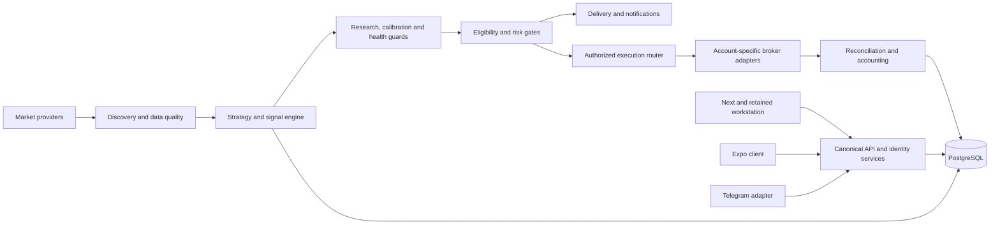

# SignalRankAI master execution contract

This is the current execution and handoff authority for the user's Stage 1
recovery mission. It does not grant production deployment or live trading
authority. Machine-readable revision identities are in [baseline.json](baseline.json).
The integration target is `main`, via `fix/stage1-canonical-reconciliation-20261014`.

## Scope and acceptance

Recover and reconcile the canonical code/requirements baseline; retain every
discoverable requirement; inspect branch/history/PR/issue/deployment evidence;
correct safe foundational defects; test integrated behavior; commit the evidence
and an exact next-stage starting point. Preserve production data, credentials,
existing functionality and operational safeguards. Do not change real-money
permissions. Stage 1 is **not complete merely because this document exists**.

Current acceptance is tracked in [RELEASE_BLOCKERS.md](RELEASE_BLOCKERS.md).
Unreviewed source clauses remain explicit acceptance failures rather than being
silently dropped. Source preservation, implementation, local verification and
operational release acceptance are distinct claims.

Use only these requirement statuses:

| Status | Meaning |
| --- | --- |
| IMPLEMENTED | Identified code exists; stated scope and limitations apply. |
| VERIFIED | Current, retained, matching evidence proves this exact requirement and all its acceptance clauses. |
| BLOCKED_EXTERNAL | A named external dependency prevents acceptance; owner and next action must be recorded. |
| FAILED | Acceptance failed or clause-specific acceptance review remains unresolved; the reason must say which. |
| NOT_IMPLEMENTED | Required behavior is absent; a catalogue entry or placeholder does not implement it. |
| NOT_APPLICABLE | A reviewed scope decision excludes the requirement, with its source and rationale retained. |

Every requirement records ID, source, current implementation, component,
verification method, status, test evidence and associated commit. Source sections
also retain full text/clauses and hashes. Overlapping historical registries are
not separate feature counts. `FAILED: CLAUSE_ACCEPTANCE_NOT_ESTABLISHED` means
unfinished review, not proof that the feature is absent. Interface declarations
are IMPLEMENTED only at declaration scope; they do not certify user journeys.

## Source precedence and preservation

The current user mission and its production-safety restrictions control this
work. More specific current requirements refine older sources; conflicts remain
visible until resolved. Historical completion reports are evidence candidates,
never acceptance authority. Optional ideas must not become requirements without
an explicit source or decision.

Primary preserved sources include:

- [2026 master blueprint](../SignalRank_Master_Blueprint_2026.md), its original attachment and the September 25 specifications under `docs/specs/2026-09-25/`.
- [October 2 master directive](../SIGNALRANKAI_MASTER_DIRECTIVE_20261002.txt) and its 431-clause registry.
- The five October 5 specifications under `docs/specs/20261005/`: research validation, customer execution, completion/resilience, web/mobile and multi-broker. Their 560 source sections remain intact.
- [Supplied research content](../specs/20261010/research-source-supplied.md), which supersedes older source-unavailable claims, and [ecosystem frontend requirements](../specs/20261012/ecosystem-frontend.md).
- V7 requirements, prior traceability/ledgers and all current documentation; 19 distinct divergent historical documentation versions are retained in [historical-sources.json](evidence/historical-sources.json).
- All 1,049 distinct historical Markdown/text versions across 535 root/documentation paths, including removed documents, are indexed in [historical-documentation-index.json](evidence/historical-documentation-index.json) and retained in its compressed JSONL archive. Fourteen credential-shaped spans were conservatively redacted; original blob IDs and hashes remain. These are historical sources, not 1,049 new active requirements.
- Repository PR/issue bodies and metadata in `evidence/`. Closed/merged state never proves runtime behavior.

[REQUIREMENTS_TRACEABILITY.md](REQUIREMENTS_TRACEABILITY.md) and
[requirements.json](requirements.json) retain the complete inventory. The compact
reviewed domain register is [canonical_requirements.json](canonical_requirements.json).
`python scripts/build_release_inventory.py --check` detects drift and omitted
current source/interface rows. The generator cannot mark anything VERIFIED.
`scripts/completion_matrix.py` additionally rejects verification receipts with
missing/mismatched files, hashes, source scope or unsuccessful/empty/skipped tests.

## Canonical architecture

The current architecture is a Python/FastAPI service and role-separated workers,
backed by PostgreSQL, with Redis where configured. `railway_main:app` is the
deployment entry point; `web.app` mounts canonical platform and versioned APIs.
The `frontend` Next application owns the new public presentation and configured
workspace mode; the mature `web/platform_app` workstation remains supported.
The Expo `mobile` client and Telegram adapter use the same identity, account,
entitlement, execution and reporting services. No client decides its own role,
tier, balance, price, fill or trading authorization.

Execution is a separately authorized side effect. Paper, shadow, demo, prop and
personal-live records retain distinct provenance and account ownership. Broker
connection support is separate from trading adapter support. PostgreSQL is the
account/evidence authority; client cache and process-local state cannot certify
balances, promotion, provider freshness or completed orders.

The active Alembic head is `0055_user_renewal_default`. Its upgrade changes only
the default for future users; it does not rewrite existing renewal flags or
entitlements. Production remains at its independently observed deployed revision
until a separate release procedure proves otherwise.

## Required release gates

All gates apply to the exact release SHA, configuration, schema and environment.
No previous branch's evidence can stand in for a new release. The executable
manifest remains `certification/release_manifest.yaml`; these operational gates
are additional acceptance requirements, not implied successful outcomes.

1. **Source and build:** reviewed PR, reconciled dependencies, current inventory,
   secret/security checks, required CI/cleanroom suites, immutable build digest,
   migration graph and source/schema provenance.
2. **Staging isolation:** dedicated credentials, bot, database, payment test mode,
   broker demo accounts and provider entitlements. Prove no production fallback.
3. **User journeys:** real browser/native/Telegram registration, activation,
   session expiry, consent, roles, billing and administration with negative
   ownership cases. Preserve returning PWA and legacy-workspace behavior.
4. **Market/research:** fresh correctly classified data; supported strategies,
   closed bars, event-time inputs, fees/slippage, out-of-sample calibration,
   immutable evidence, forward health and guarded model/profile promotion.
5. **Broker authority:** identifiable owner/account/environment; explicit,
   revocable broker authorization and per-account allowed instruments/actions.
   Connection credentials alone are not authority. This Stage 1 does not grant it.
6. **Reconciliation:** durable order-intent/idempotency keys, broker receipts,
   partial-fill/cancel/modify/close accounting, balances/positions and restart
   recovery. Ambiguous acknowledgement must halt/reconcile, never blindly retry.
7. **Loss and exposure:** daily/aggregate loss, drawdown, sizing, currency,
   leverage, portfolio correlation, prop constraints and stale-data limits.
   Concurrent requests must not exceed limits; missing state must block execution.
8. **Emergency controls:** demonstrate stop-new-orders, revoke authorization,
   cancel pending orders and explicitly authorized position-close procedures;
   alerting and restart must preserve the stop state. Never claim a kill switch
   automatically flattens positions unless independently demonstrated.
9. **Real execution evidence:** account-bound provider/broker demo receipts and
   independently reconciled statements for each supported operation. Local mocks,
   UI success, paper fills and catalogue labels cannot satisfy this gate. Any
   later real-money pilot needs separate explicit authority and actual broker
   evidence; do not create that evidence during Stage 1.
10. **Operations:** exact-SHA restore drill, measured recovery objectives,
    monitoring/alerts, rollback/reconciliation and stable soak with no unresolved
    P0/P1 failures. Human/operator approvals must be recorded, not inferred.

## Next-run procedure

Read this contract, baseline, blockers, branch reconciliation and completion
evidence before editing. Inspect `git status` and other worktrees. Continue the
existing integration branch; do not restart from old `main` or the blueprint
snapshot. Finish the highest-priority unresolved acceptance items first, retain
each source clause, and update the six documents with every new commit/evidence
set. Use isolated local services and `scripts/stage1_local_checks.py`; its
credentials-free child environment does not certify external systems.
