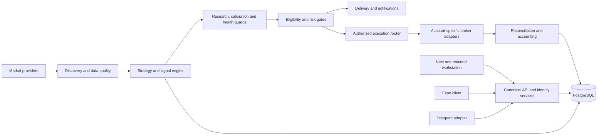

# SignalRankAI master execution contract

## Continuation, 28 October 2026 — engine stall root cause, owner strategy, dependency verification

Branch `feat/frontend-rebuild-and-stage1-hardening`, commits `6c14af7d` and `5b7eb4c5` after `dce7bd8c`. Stage 1 and release remain NO-GO. Railway was read only (environment status, deployment lists and logs); nothing was deployed, restarted, migrated or reconfigured.

- **Production engine root cause (CX-Q-05, CX-FACT-06).** `striking-optimism` logged its last pipeline step at 2026-10-22 08:08:30 UTC (`PENGUUSDT`), immediately after `Postgres-R8Lr` was redeployed at 08:07:47 and the engine's connections broke at 08:08:35; it has logged nothing since, yet Railway reports it Online with one running replica and no failures. Thirteen database calls in the loop use `run_sync` without a timeout. Fix: an engine stall watchdog that logs the stuck call's stack, publishes a not-ready `stalled` heartbeat and, for a dedicated engine role, exits with code 70 so the `ON_FAILURE` policy restarts it (`5b7eb4c5`, 7 tests). Not deployed: the running engine stays stalled until it is restarted.
- **Other signal-drought causes seen in the same logs (not changed):** several FX, index and commodity providers returned 0 candles (Tiingo, Twelve Data, Polygon, yfinance), and BTCUSDT candidates were refused with `risk/expectancy_unavailable`.
- **PR #202 was not deployed.** Railway created no deployment for `4f4f6d33`; every application service still runs `9865a3d1` (12 Oct). Earlier pushes show automatic deployments SKIPPED and later deployed manually.
- **Owner strategy videos.** The 23 Jun 2026 (XAUUSD) and 6 Aug 2026 (USDCAD) recordings were reviewed from 67 extracted frames and a machine transcript (the first recording's audio is unusable). Implemented as `strategies/zone_rejection.py` (`Order Block ABC (Top-Down)`, `order-block-abc-v1`): 1d/4h order block, premium/discount filter on the 1d range, 4h break of structure, 15m (else 5m) ABC where C takes A and the latest closed bar is the first close through B, target the nearer of the 50% equilibrium and the 4h liquidity, minimum 2R. Group `zones`, 5m/15m capability, disabled unless `ZONE_REJECTION_STRATEGY_ENABLED` is set (`6c14af7d`, 11 tests). No backtest or shadow evidence yet; enabling needs owner approval.
- **Full Python suite with the upgraded dependencies** at `fa223df4` (Python 3.12 venv from `requirements.lock`, owned PostgreSQL 17 migrated from empty, `SIGNALRANK_POSTGRES_INTEGRATION_REQUIRED=1`): **4,145 passed, 1 failed, 2 skipped**. The failure, `test_provider_certification_boundaries.py::test_positive_infinity_cannot_hang_any_timestamp_normalizer`, is a 15 s subprocess deadline hit by cold imports in the new venv; it passes on re-run in about 4 s (twice).

## Continuation, 27–28 October 2026 — second pass: engine diagnostics, risk, identity merge, security

Branch `feat/frontend-rebuild-and-stage1-hardening`, commits `21e5c509` … `f95f9785`. Stage 1 and release remain NO-GO; nothing was merged, deployed or migrated against any shared system, and no financial permission changed. Environment for all evidence below: Windows 11, Python 3.13.7, an owned PostgreSQL 17 cluster on `127.0.0.1:55434` created for this session, Node 22.19 with npm 11.17.0. Not CI, staging or production.

- **Engine stall diagnostics (P0).** Five early cycle exits (circuit breaker active or failing closed, no assets, off-market throttle, empty queue) wrote no `engine:last_cycle`, so a live engine skipping every cycle looked stopped. They now publish `status: skipped` with the reason; readiness still treats `skipped` as not ready and names the reason (`2288ce6e`). The production root cause still needs Railway logs.
- **Runtime identity (CX-OBS-03).** `/version` reports the code's Alembic head and a UTC build stamp written by the Nixpacks build phase (`bd257421`, `131224e7`). `image_digest` stays `unknown` under Nixpacks.
- **Migration rehearsal.** `0053 → 0055 → 0053 → 0055` with plain Alembic and `0053 → 0055` through `scripts/controlled_migrate.py`, on 5,000 users and 200,000 decision rows: existing `auto_renew` values unchanged, index valid, downgrade clean. Found that the guarded migration also needs `PRODUCTION_DB_VOLUME_SIZE_MB` and a volume observation under one hour old; the promotion plan now lists it. Evidence: `evidence/continuation-20261027/migration_rehearsal_0053_0055.json`.
- **Risk.** Audited strategy/instrument/asset-class kill switches enforced at the MT5 and Bybit chokepoints, fail closed (`31770c17`). Real-PostgreSQL race: 12 simultaneous reservations against a limit of 3 approve exactly 3; found and fixed every quota refusal being reported as `execution_quota_unavailable` (`41e16c3b`). `engine/correlation_guard.py` and `core/risk_authority.py` are not wired into runtime.
- **Focused universe in ML training** (`fdcfefe0`) and **per-strategy/instrument/timeframe/layer rejection breakdowns** on `/quality` and the web Quality view (`6cc5f94c`, `b51d3db7`).
- **Telegram ↔ web account merge.** A web account linking a Telegram identity with existing bot history stopped at `merge_review` forever. Reviewed merges can now be previewed and completed (owner endpoints, `python -m tools.complete_account_merge`) in one transaction: rows referencing the archived account move only when no unique index collides and owned parent rows move with them; nothing is deleted; credentials and sessions never move; paid tier and the renewing subscription follow the person (`3febf802`). 5 real-PostgreSQL tests.
- **Security.** Next.js `16.3.8 → 16.4.2` (critical unauthenticated RCE advisories GHSA-2464-fhr4-w9xw, GHSA-673q-mjm6-r5xr) and zod; `npm audit`: 0 vulnerabilities (`630163db`). pip-audit of `requirements.lock`: 49 advisories in aiohttp, certifi, opentelemetry-api and Pillow; bumped to aiohttp 3.14.5, certifi 2026.10.19, OpenTelemetry 1.45.1/0.66b1, Pillow 13.0.0, respecting the 7-day release-age rule (`242eefc3`). Baseline `nosniff`, `no-store` and HTTPS-only HSTS on direct API responses; HSTS on the web app (`eaa11d9d`).
- **Audit.** Global and scoped kill-switch changes now write `security_events` rows, best effort so a switch never fails on audit (`f95f9785`).
- **Web.** Production build run locally against the local API. At 320 px the public Menu button was off-screen (fixed, regression test). A window with zero quality decisions now says the engine most likely did not run. Basic accessibility sweep clean on Settings, Signals and Login.
- **Tests.** Full Python suite at `eaa11d9d` on real PostgreSQL 17 (database migrated from empty to `0055`, `SIGNALRANK_POSTGRES_INTEGRATION_REQUIRED=1`): **4,138 passed, 4 failed, 0 skipped**. Failures: V7 governance freshness (artifacts not yet regenerated at that commit; regenerated before push), `release_provenance[isolated_metadata]` (environmental: `alembic` only in user site-packages, excluded by `python -I`), and two host-timezone privacy cases that call POSIX-only `time.tzset` (now skipped where unavailable, `4d8d596d`). Frontend at `630163db`: tsc, eslint, `next build` and 108 node tests pass.
- **Production promotion** was requested again; not executed. It still needs the owner phrase `PROMOTE_TO_PRODUCTION`, Railway access for backup and `EXPECTED_RELEASE_COMMIT` on every service, and the guarded migration (plan updated with the volume gate). The promoted code would now also change the Nixpacks build phase and Python/Node dependency versions listed above.

## Continuation, 27 October 2026 — runtime schema identity

Branch `feat/frontend-rebuild-and-stage1-hardening` (from `5f848d96`; code commit `bd257421`). Stage 1 and release remain NO-GO; nothing was merged, deployed or migrated, and no financial permission changed.

- CX-OBS-03 (partial fix): `/version` now reports the code's single Alembic head when `EXPECTED_SCHEMA_HEAD` is unset, resolved independently of the working directory, instead of `unknown`. An explicit `EXPECTED_SCHEMA_HEAD` still wins. `build_timestamp` and `image_digest` still depend on build-provided variables and stay `unknown` until the build sets them. Test: `tests/test_version_schema_head_20261027.py` (3 passed locally; the first case fails on the previous code). Not deployed, so production still reports `unknown` until an authorized promotion.
- Production promotion was requested in chat on 27 Oct without the `PROMOTE_TO_PRODUCTION` phrase or the prerequisites in [PRODUCTION_PROMOTION_PLAN_20261024.md](PRODUCTION_PROMOTION_PLAN_20261024.md) (backup evidence, `EXPECTED_RELEASE_COMMIT` on every service, guarded `0054`/`0055` migration). Not executed.

## Continuation, 24 October 2026 — frontend rebuild, live readiness finding, independent audit

Branch `feat/frontend-rebuild-and-stage1-hardening` (from `393f3d88`; commits `7946fa25`, `840abd90`, `801780d4`, `7a63d5ac`, `8a7d3e3b` and this documentation commit). Stage 1 and release remain NO-GO; nothing was merged, deployed or migrated, and no financial permission changed.

- Web frontend rebuilt on a new design system; billing (server-priced Paystack checkout, verified confirmation, auto-renew cancel, refund review) and signal feedback wired to existing APIs. Local evidence: tsc, eslint, `next build`, 98 node tests at the time of commit; 61/61 pre-rebuild API calls and 11/11 routes retained (`frontend/scripts/api-baseline.test.mjs`).
- Focused-universe admission now guards both signal persistence paths and the MT5/Bybit execution chokepoints (no-op unless enabled in staging). HTTP 451 classified as `REGION_RESTRICTED`; Binance region blocks logged and backed off.
- Live read-only `/readyz` (deployed `9865a3d1`) returns 503: only `engine_runtime` fails — the `engine:last_cycle` heartbeat is absent, so the production engine is not cycling (Engine Pulse: 0 signals in window). Probe now reports `engine_heartbeat_missing`. Root cause needs Railway logs (blocked: access). Production DB is at `0053`; repository head `0055`.
- New owner source `message.txt` (SHA-256 `b78374d0…`) consolidated privately into 287 requirement IDs; hashes and anchors only in `evidence/continuation-20261024/source_intake.json`.
- Full Python suite at clean commit `e9b2b368` on a local PostgreSQL 16.2 database migrated from empty to `0055`: **4,098 passed, 0 failed, 1 skipped** (pyarrow not installed); multi-user isolation suite 5/5. Three pre-existing test portability/isolation defects fixed. Local only; GitHub Actions remains billing-locked. Limits in the audit §8.

Full details, classifications and information gaps: [INDEPENDENT_ACCEPTANCE_AUDIT_20261024.md](INDEPENDENT_ACCEPTANCE_AUDIT_20261024.md).

## Stage 0 safe local Git and historical forensics, 22–23 October 2026

The exact observed source is e01e7c41f49a3e35335b00edc2de97367aa2dade. Evidence: [Stage 0 forensics index](evidence/continuation-20261022/index.json). Stage 1 and release remain NO-GO.

Non-destructive remote fetch confirmed zero stale remote refs; `origin/fix/stage1-canonical-reconciliation-20261014` is at 393f3d88. Branch audit across 247 refs (4,695 reachable commits) verified 218 ancestor-preserved refs, 1 patch-equivalent/merge-only ref, and 28 divergent refs containing 118 unique commits matching historical reviewed dispositions with 0 missing and 0 moved heads. Single migration head `0055_user_renewal_default` is confirmed. 18 worktrees discovered: 17 clean, 1 dirty worktree (`.pytest-tmp/release-ci-closure-20261007`) preserved untouched with 25 uncommitted entries analyzed. Draft PR #201 remains OPEN under active ruleset 24410166; hosted CI runs remain failed at zero steps due to account billing lock. Live route check on `https://www.signalrank.criloxsolutions.com` confirms `/` (200 JSON), `/login` (404), `/app` (200 HTML), `/healthz` (200 JSON), `/pricing` (404); public Next cutover remains unserved. Railway CLI session is expired (BLOCKED_EXTERNAL for fresh authenticated control-plane re-verification). All 5 release governance checks pass with 0 drift.

## Exact correction verification, 18 October 2026

The exact tested source is 393f3d88d6018d01c3f04234cc9c44b23a5de8fc. Evidence: [correction index](evidence/continuation-20261018/correction-393f3d88/index.json). Stage 1 and release remain NO-GO.

The immutable-attempt wrapper and legacy HTML correction have passed a clean full local system run: **4,080 passed, zero failed/errors/skips** across 32 checks. OpenGrep completed its probe and strict scan: 575 files, 476 rules, zero findings, zero errors. The legacy production-build browser drill also passed using synthetic accounts, an owned migrated PostgreSQL database and a confirmed cleanup of servers, database and key.

The runtime source is now frozen at this revision. The later handoff commit carries only evidence and governance material; it is not a second tested-code claim. The passing checks neither exercise external providers nor authorize broker, payment, Telegram, native-device, staging, production or real-money behavior. Retain the mobile dependency audit failure and every prior failed diagnostic.

## Frozen local pass and follow-up correction, 18 October 2026

The exact tested source is 2ee0a918d915549f7f5ce59d59f0a8a07d2202a9. Evidence: [frozen run index](evidence/continuation-20261018/frozen-2ee0a918/index.json). Stage 1 and release remain NO-GO.

The full system run passed 4,076 tests, zero failed/errors/skipped, plus all 12 local system checks. Both actual browser workspace modes passed and their owned servers, databases and keys were cleaned up. These results replace the stale-governance failure only at local suite scope.

A strict static scan failed on bare ampersands in two legacy HTML pages; the characters are now escaped. A synthetic probe and four regressions confirmed that the local wrapper could overwrite previous attempts and lose launch failures. Exclusive output creation and explicit launch-failure receipts fix that defect; ten modified-source wrapper tests pass. Freeze and verify this correction next. Do not extend the 2ee0a918 receipt to these later source edits.

Thirteen seed dispositions now have explicit reviewed mappings/gaps. Full semantic reconciliation is unfinished; no whole requirement has been promoted to verified. Use unique attempt names. Keep failed and partial artifacts. The generation order below remains mandatory.

## Verification continuation, 18 October 2026

Clean unchanged 7c3f7e0f completed the full local system run: 4,075 passed,
one failed, zero skipped. The sole failure is the generated V7 governance
inventory, which was produced before the final retained evidence and register
updates. The failure is retained in evidence/continuation-20261018/index.json;
no runtime behavior is waived by identifying the generator-order error.

On that same commit, all five local manifest gates, 63 frontend tests, 53 mobile
tests, frontend lint, mobile typecheck, Android/iOS JS exports and the real Next
browser drill passed. The browser drill used synthetic accounts and an owned
migrated PostgreSQL database; server/database/key cleanup succeeded. These are
local checks, not native-device, provider, broker, financial or staging approval.
Stage 1 and the overall release remain NO-GO.

Generation order for the correction: retain/stage evidence logs first, update
baseline/docs, build_release_inventory, crosschat_intake, then build_v7_governance.
Check all three without writing before freezing. Do not add evidence after the
final governance generation without regenerating it. Run the full suite and
remaining browser/security checks from that exact unchanged correction commit.

Verification follow-up: 5f7ae60c passed the five local manifest gates, 63 frontend
and 53 mobile tests, but its full run was interrupted after an Android export
rewrote tracked legacy build artifacts. Those generated files were restored;
future exports target ignored artifacts. Missing Chromium is being installed.
A synthetic probe also exposed missing receipt metadata validation in the new
intake validator; environment, command, timestamp and scope are now mandatory,
with four negative regressions. No requirement was promoted to VERIFIED.
The next frozen commit must supply fresh full-suite acceptance.

## Active cross-chat continuation, 17 October 2026

The supplied package README and complete master contract, plus the newly attached
recovery/intelligence addendum, now control the intake scope. The previous
recovery request remains preserved. Read requirements_conflicts.md for explicit
precedence and privacy decisions. The raw package is deliberately ignored.

scripts/crosschat_intake.py validates both original DOCX bodies against every
exported clause and source hash, checks the complete heading sequence and seeds,
and produces requirements_universe.jsonl, source_coverage.json and the readable
CROSSCHAT_REQUIREMENTS_MATRIX.md. These retain source references, not private
wording. All 14,226 source blocks match. This is complete mechanical ingestion,
not complete semantic review or implementation. Four seed dispositions currently
map focused-universe work and gaps; the remaining reviews stay open. Older
registries and all child clauses remain intact and referenced.

The new register uses the eight dispositions requested by the latest owner
instruction, together with separate applicability/review state. Historical status
vocabularies below still describe their original registers. Never promote their
labels into current acceptance. The absent blueprint_modules.csv and unsupplied
original chats are SOURCE_NOT_AVAILABLE. Continue Stage 1; NO-GO remains.

## Active continuation, 16 October 2026

The full current owner request is preserved verbatim in
[recovery-request.md](../specs/20261016/recovery-request.md). Continue Stage 1
before later phases. It conditionally authorizes non-destructive deployment
after every mandatory release gate passes; those gates remain unsatisfied.
Live trading permissions and production test/migration/restore operations remain
prohibited during this recovery.

The checkout has safely fast-forwarded from 336dd28f to the fetched PR #201 head,
51d2f59ed2c1553841fc24dda98689ffb26a0b7a. Current repairs harden the existing
staging-only focused scanner: shared strict configuration validation, rejection
of conflicting environment labels, and recent analysis-readiness DB selection.
Registry state and capability flags do not certify actual market data or
account-specific execution. The entire focused-universe requirement remains open.
Use scripts/stage1_local_checks.py --require-clean for frozen acceptance;
the wrapper now fails if source or Git identity changes during a successful command.

This is the current execution and handoff authority for the user's Stage 1
recovery mission. It does not grant production deployment or live trading
authority. Machine-readable revision identities are in [baseline.json](baseline.json).
The integration target is `main`, via `fix/stage1-canonical-reconciliation-20261014`.

## Scope and acceptance

Recover and reconcile the canonical code/requirements baseline; retain every
discoverable requirement; inspect branch/history/PR/issue/deployment evidence;
correct safe foundational defects; test integrated behavior; commit the evidence
and an exact next-stage starting point. Preserve production data, credentials,
existing functionality and operational safeguards. Do not change real-money
permissions. Stage 1 is **not complete merely because this document exists**.

Current acceptance is tracked in [RELEASE_BLOCKERS.md](RELEASE_BLOCKERS.md).
The local runtime baseline is c411ebbb67d35fdad91d1281b667a7ee8272dd38:
3,984 tests and both browser modes passed on clean unchanged source. This does
not close source-specific acceptance or authorize the next stage. Read
COMPLETION_EVIDENCE.md for retained receipts and their exact limits.
Unreviewed source clauses remain explicit acceptance failures rather than being
silently dropped. Source preservation, implementation, local verification and
operational release acceptance are distinct claims.

Use only these requirement statuses:

| Status | Meaning |
| --- | --- |
| IMPLEMENTED | Identified code exists; stated scope and limitations apply. |
| VERIFIED | Current, retained, matching evidence proves this exact requirement and all its acceptance clauses. |
| BLOCKED_EXTERNAL | A named external dependency prevents acceptance; owner and next action must be recorded. |
| FAILED | Acceptance failed or clause-specific acceptance review remains unresolved; the reason must say which. |
| NOT_IMPLEMENTED | Required behavior is absent; a catalogue entry or placeholder does not implement it. |
| NOT_APPLICABLE | A reviewed scope decision excludes the requirement, with its source and rationale retained. |

Every requirement records ID, source, current implementation, component,
verification method, status, test evidence and associated commit. Source sections
also retain full text/clauses and hashes. Overlapping historical registries are
not separate feature counts. `FAILED: CLAUSE_ACCEPTANCE_NOT_ESTABLISHED` means
unfinished review, not proof that the feature is absent. Interface declarations
are IMPLEMENTED only at declaration scope; they do not certify user journeys.

## Latest user scope: focus, not all-asset expansion

The user's 15 October 2026 instruction narrows **new active scanning and new
entries** to 10 preferred core candidates and at most five qualified optional
candidates per asset class (crypto, forex, index, equity and commodity). The
current Stage 1 scope record is
[current_scope_20261016.json](current_scope_20261016.json), validated by
`python -m scripts.validate_current_scope`. These candidate labels are not
broker certifications, active-trading permission or a completed runtime
implementation. The old broad universe remains available as historical
research context, and existing positions require continued lifecycle
management and reconciliation even if their instruments are excluded from
new entries. No automatic asset activation, production permission change,
live order or provider fallback is authorized by this scope record.

The preceding scope change is an explicit unresolved source-specific acceptance
item (ST1-FOCUSED-UNIVERSE) until every runtime path and account-specific
execution boundary is proven. A previous request to scan all assets must not
silently override the newer active-universe ceiling. Stage 1 must preserve this
conflict decision in the next-stage handoff; do not certify product readiness
from the document or validator alone.

## Source precedence and preservation

The current user mission and its production-safety restrictions control this
work. More specific current requirements refine older sources; conflicts remain
visible until resolved. Historical completion reports are evidence candidates,
never acceptance authority. Optional ideas must not become requirements without
an explicit source or decision.

Primary preserved sources include:

- [2026 master blueprint](../SignalRank_Master_Blueprint_2026.md), its original attachment and the September 25 specifications under `docs/specs/2026-09-25/`.
- [October 2 master directive](../SIGNALRANKAI_MASTER_DIRECTIVE_20261002.txt) and its 431-clause registry.
- The five October 5 specifications under `docs/specs/20261005/`: research validation, customer execution, completion/resilience, web/mobile and multi-broker. Their 560 source sections remain intact.
- [Supplied research content](../specs/20261010/research-source-supplied.md), which supersedes older source-unavailable claims, and [ecosystem frontend requirements](../specs/20261012/ecosystem-frontend.md).
- V7 requirements, prior traceability/ledgers and all current documentation; 19 distinct divergent historical documentation versions are retained in [historical-sources.json](evidence/historical-sources.json).
- All 1,049 distinct historical Markdown/text versions across 535 root/documentation paths, including removed documents, are indexed in [historical-documentation-index.json](evidence/historical-documentation-index.json) and retained in its compressed JSONL archive. Fourteen credential-shaped spans were conservatively redacted; original blob IDs and hashes remain. These are historical sources, not 1,049 new active requirements.
- Repository PR/issue bodies and metadata in `evidence/`. Closed/merged state never proves runtime behavior.

[REQUIREMENTS_TRACEABILITY.md](REQUIREMENTS_TRACEABILITY.md) and
[requirements.json](requirements.json) retain the complete inventory. The compact
reviewed domain register is [canonical_requirements.json](canonical_requirements.json).
`python scripts/build_release_inventory.py --check` detects drift and omitted
current source/interface rows. The generator cannot mark anything VERIFIED.
`scripts/completion_matrix.py` additionally rejects verification receipts with
missing/mismatched files, hashes, source scope or unsuccessful/empty/skipped tests.

## Canonical architecture

The current architecture is a Python/FastAPI service and role-separated workers,
backed by PostgreSQL, with Redis where configured. `railway_main:app` is the
deployment entry point; `web.app` mounts canonical platform and versioned APIs.
The `frontend` Next application owns the new public presentation and configured
workspace mode; the mature `web/platform_app` workstation remains supported.
The Expo `mobile` client and Telegram adapter use the same identity, account,
entitlement, execution and reporting services. No client decides its own role,
tier, balance, price, fill or trading authorization.

Execution is a separately authorized side effect. Paper, shadow, demo, prop and
personal-live records retain distinct provenance and account ownership. Broker
connection support is separate from trading adapter support. PostgreSQL is the
account/evidence authority; client cache and process-local state cannot certify
balances, promotion, provider freshness or completed orders.

The active Alembic head is `0055_user_renewal_default`. Its upgrade changes only
the default for future users; it does not rewrite existing renewal flags or
entitlements. Production remains at its independently observed deployed revision
until a separate release procedure proves otherwise.

## Required release gates

All gates apply to the exact release SHA, configuration, schema and environment.
No previous branch's evidence can stand in for a new release. The executable
manifest remains `certification/release_manifest.yaml`; these operational gates
are additional acceptance requirements, not implied successful outcomes.

1. **Source and build:** reviewed PR, reconciled dependencies, current inventory,
   secret/security checks, required CI/cleanroom suites, immutable build digest,
   migration graph and source/schema provenance.
2. **Staging isolation:** dedicated credentials, bot, database, payment test mode,
   broker demo accounts and provider entitlements. Prove no production fallback.
3. **User journeys:** real browser/native/Telegram registration, activation,
   session expiry, consent, roles, billing and administration with negative
   ownership cases. Preserve returning PWA and legacy-workspace behavior.
4. **Market/research:** fresh correctly classified data; supported strategies,
   closed bars, event-time inputs, fees/slippage, out-of-sample calibration,
   immutable evidence, forward health and guarded model/profile promotion.
5. **Broker authority:** identifiable owner/account/environment; explicit,
   revocable broker authorization and per-account allowed instruments/actions.
   Connection credentials alone are not authority. This Stage 1 does not grant it.
6. **Reconciliation:** durable order-intent/idempotency keys, broker receipts,
   partial-fill/cancel/modify/close accounting, balances/positions and restart
   recovery. Ambiguous acknowledgement must halt/reconcile, never blindly retry.
7. **Loss and exposure:** daily/aggregate loss, drawdown, sizing, currency,
   leverage, portfolio correlation, prop constraints and stale-data limits.
   Concurrent requests must not exceed limits; missing state must block execution.
8. **Emergency controls:** demonstrate stop-new-orders, revoke authorization,
   cancel pending orders and explicitly authorized position-close procedures;
   alerting and restart must preserve the stop state. Never claim a kill switch
   automatically flattens positions unless independently demonstrated.
9. **Real execution evidence:** account-bound provider/broker demo receipts and
   independently reconciled statements for each supported operation. Local mocks,
   UI success, paper fills and catalogue labels cannot satisfy this gate. Any
   later real-money pilot needs separate explicit authority and actual broker
   evidence; do not create that evidence during Stage 1.
10. **Operations:** exact-SHA restore drill, measured recovery objectives,
    monitoring/alerts, rollback/reconciliation and stable soak with no unresolved
    P0/P1 failures. Human/operator approvals must be recorded, not inferred.

## Next-run procedure

Read this contract, baseline, blockers, branch reconciliation and completion
evidence before editing. Inspect `git status` and other worktrees. Continue the
existing integration branch; do not restart from old `main` or the blueprint
snapshot. Finish the highest-priority unresolved acceptance items first, retain
each source clause, and update the six documents with every new commit/evidence
set. Use isolated local services and `scripts/stage1_local_checks.py`; its
credentials-free child environment does not certify external systems.
